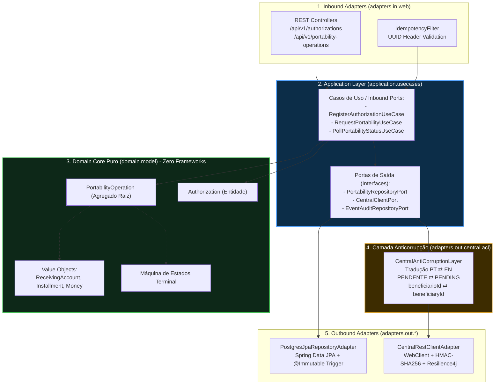
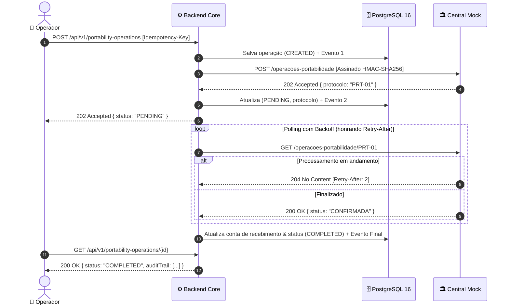

# ⚡ ConsigPort — Plataforma de Portabilidade de Convênios de Desconto em Folha

> Solução fullstack para portabilidade de convênios de desconto em folha, orquestração assíncrona, integridade criptográfica HMAC-SHA256, idempotência estrita e trilha de auditoria append-only imutável.
>
> 🚀 **Desenvolvido com:** Java 21, Spring Boot 3.5.x, React 19.2 (Vite RSC), PostgreSQL 16, OpenAPI 3.1 e Docker Compose.

---

## 📌 Sumário Executivo e Visão Geral

O **ConsigPort** assume o papel de credor cessionário de parcelas de convênios consignados. A plataforma interage com uma **Central de Convênios** externa para:
1. **Capturar a autorização (*opt-in*)** do beneficiário vinculada a um identificador único.
2. **Consultar a agenda de descontos futuros** com parcelas elegíveis (`OPEN`).
3. **Solicitar a operação de portabilidade** com integridade HMAC e chave de idempotência (`Idempotency-Key`).
4. **Acompanhar o ciclo assíncrono** com protocolo retornado (`202 Accepted`), polling inteligente com backoff honrando `Retry-After: 2` e estados terminais (`COMPLETED` ou `REJECTED`).
5. **Manter trilha de auditoria append-only imutável** via gatilhos no banco de dados e eventos de domínio.

---

## 🏛️ Topologia de Execução do Monorepo

O sistema é composto por 3 módulos executáveis independentes e um banco relacional, orquestrados em rede bridge isolada via **Docker Compose**:

```mermaid
flowchart TB
    subgraph Client["Cliente / Navegador"]
        Browser["👤 Operador ConsigPort (Browser)"]
    end

    subgraph Platform["Plataforma ConsigPort (consigport-net)"]
        Frontend["🌐 frontend/\nReact 19.2 + Vite RSC + Tailwind 4\n(Porta: 5173)"]
        Backend["⚙️ backend/\nJava 21 + Spring Boot 3.5.x\nHexagonal + DDD + ACL\n(Porta: 8080)"]
        Postgres[("🗄️ PostgreSQL 16\nOperações, Auditoria, Idempotência\n(Porta: 5432)")]
    end

    subgraph External["Ambiente Externo Simulado"]
        Mock["🏛️ central-convenios-mock/\nCentral de Convênios (Mock Stateful)\nSimulação 202/204 + Delay 2s + Falhas\n(Porta: 8081)"]
    end

    Browser -->|HTTP / SSR| Frontend
    Frontend -->|REST /api/v1| Backend
    Backend -->|JDBC / Flyway| Postgres
    Backend -->|REST + HMAC-SHA256 (Contrato PT)| Mock

    classDef core fill:#161b22,stroke:#58a6ff,stroke-width:2px,color:#fff;
    classDef ext fill:#161b22,stroke:#d29922,stroke-width:2px,color:#fff;
    classDef db fill:#161b22,stroke:#bc8cff,stroke-width:2px,color:#fff;
    class Frontend,Backend core;
    class Mock ext;
    class Postgres db;
```

### Módulos e Portas

| Módulo | Tecnologia | Responsabilidade | Porta |
|---|---|---|:---:|
| **`frontend/`** | React 19.2 + Vite RSC + Tailwind 4 | Interface do operador, streaming SSR, hidratação seletiva, tema Matrix e timeline de auditoria. | `5173` |
| **`backend/`** | Java 21 + Spring Boot 3.5.x | Núcleo de negócio com Arquitetura Hexagonal, DDD puro, Camada Anticorrupção (ACL), HMAC, polling e eventos. | `8080` |
| **`central-convenios-mock/`** | Java 21 + Spring MVC (em memória) | Mock stateful da Central externa com contrato em português, respostas assíncronas (202/204), delay e injeção de falhas. | `8081` |
| **`postgres`** | PostgreSQL 16 Alpine | Persistência relacional com migrações Flyway e triggers de imutabilidade. | `5432` |

---

## ⬡ Arquitetura Hexagonal & Camada Anticorrupção (ACL)

O backend segue a **Arquitetura Hexagonal (Ports & Adapters)** com **Domain-Driven Design (DDD)** estrito:



### Principais Invariantes Arquiteturais
* **Domínio 100% Puro:** O pacote `domain` não referencia nenhuma dependência do Spring Framework, Hibernate, JPA ou bibliotecas de terceiros (validado via **ArchUnit**).
* **Camada Anticorrupção (ACL):** O vocabulário externo da Central (em português: `beneficiarioId`, `protocolo`, `PENDENTE`) não contamina o domínio (em inglês: `beneficiaryId`, `protocol`, `PENDING`).
* **Trilha Imutável (Append-Only):** A tabela `operation_events` possui trigger SQL que bloqueia qualquer operação de `UPDATE` ou `DELETE`, garantindo histórico não violável.

---

## 🔄 Ciclo de Vida da Operação & Fluxo Assíncrono



---

## 📋 Resumo das Decisões Arquiteturais (ADRs)

| ADR | Título | Decisão Central |
|---|---|---|
| [**ADR-0001**](docs/adr/0001-hexagonal-ddd-acl-e-mock-isolado.md) | Hexagonal, DDD, ACL e Mock Isolado | Domínio desacoplado de infraestrutura, isolamento da Central via ACL e simulação em módulo Java dedicado. |
| [**ADR-0002**](docs/adr/0002-integridade-hmac-e-idempotencia.md) | Integridade HMAC e Idempotência | Assinatura HMAC-SHA256 (`X-Signature`) contra replay (&plusmn;300s) e chave `Idempotency-Key` com constraint única no banco. |
| [**ADR-0003**](docs/adr/0003-assincronismo-polling-e-trilha-imutavel.md) | Assincronismo, Polling e Trilha Imutável | Resposta imediata `202`, polling com backoff respeitando `Retry-After: 2` e auditoria append-only garantida por trigger SQL. |
| [**ADR-0004**](docs/adr/0004-contrato-openapi-versionamento-e-i18n.md) | OpenAPI First, Versionamento e i18n | Contratos OpenAPI 3.1 como fonte da verdade, Spectral, oasdiff e i18n nativo (`pt-BR`, `en`, `es`). |
| [**ADR-0005**](docs/adr/0005-frontend-rsc-design-e-renderizacao.md) | Frontend RSC sem Next.js e Design Matrix | React 19.2 com Vite RSC oficial, streaming SSR, hidratação seletiva e design tokens Matrix em Tailwind 4. |
| [**ADR-0006**](docs/adr/0006-gitflow-ci-cd-docker-e-performance.md) | Gitflow, CI/CD, Docker e Performance | Fluxo Gitflow rigoroso (`main` $\leftarrow$ `staging` $\leftarrow$ `develop`), k6 para performance em CI e sem commits diretos em branches protegidas. |

---

## 🧭 Matriz de Rastreabilidade Interativa

O projeto disponibiliza uma **Matriz de Rastreabilidade Interativa em HTML/CSS** que correlaciona todos os requisitos do desafio técnico com as regras de negócio, ADRs, módulos e critérios de teste:

* 🌐 **Visualizador Interativo:** Abra [`docs/architecture/traceability-matrix.html`](docs/architecture/traceability-matrix.html) no navegador para:
  * Filtrar requisitos por busca textual em tempo real.
  * Segmentar entre **Requisitos Funcionais (RF)**, **Não-Funcionais (RNF)** e **Restrições Técnicas/IA (REST)**.
  * Inspecionar os diagramas em SVG nativo e Mermaid das camadas hexagonais e fluxos.
* 📄 **Documentação em Markdown:** Consulte [`docs/architecture/ARCHITECTURE_AND_TRACEABILITY.md`](docs/architecture/ARCHITECTURE_AND_TRACEABILITY.md).

---

## 🛡️ Portões de Qualidade (Quality Gates)

O desenvolvimento segue a política de **Portões de Qualidade Automatizados** definida em [`docs/quality/GATES.md`](docs/quality/GATES.md):

* **Localmente:**
  * Validação de documentação e links relativos: `node SDD/SKILLS/check-docs/check-docs.mjs .`
  * Validação de regras e especificações SDD: `node scripts/check-specs.mjs`
  * Validação de desenhos e arquitetura: `node scripts/check-architecture.mjs`
  * Formatação e testes unitários: `./mvnw spotless:check` e `npm test`
* **No CI/CD (GitHub Actions):**
  * Lint e quebra de contratos OpenAPI via **Spectral** e **oasdiff**.
  * Regras arquiteturais e isolamento de domínio via **ArchUnit**.
  * Cobertura de testes &ge; 80% via **JaCoCo**.
  * Testes ponta a ponta via **Playwright** (exclusivamente em ambiente Docker Compose).
  * Testes de performance via **k6** (p95 < 200ms em leitura; p95 < 500ms em escrita).

---

## 🤖 Governança de IA (AI Harness)

O ConsigPort segue o protocolo **SDD (Spec-Driven Development)** para interação segura e auditável com agentes de Inteligência Artificial:
* **Contexto em 3 Camadas (Tiers):** Detalhado no [`AGENTS.md`](AGENTS.md).
* **Visão Geral do Protocolo:** [`docs/ai-harness/HARNESS_OVERVIEW.md`](docs/ai-harness/HARNESS_OVERVIEW.md).
* **Diário de Sessões e Modelos:** [`docs/ai-harness/AI_USAGE_LOG.md`](docs/ai-harness/AI_USAGE_LOG.md).
* **Registro de Evidências:** [`SDD/docs/EVIDENCE.md`](SDD/docs/EVIDENCE.md).

---

## 🚀 Como Executar

### Pré-requisitos
* **Docker & Docker Compose** (versão 24+)
* **Java 21 JDK** (para desenvolvimento local)
* **Node.js 20+** (para validação de documentação e frontend)

### Subindo o ambiente completo
```bash
# Sobe o banco PostgreSQL, Backend Core, Mock da Central e Frontend
docker compose up -d --build

# Verifica a integridade e health dos serviços
docker compose ps
```

### URLs e Endpoints
* **Frontend Web:** `http://localhost:5173`
* **Backend API Swagger:** `http://localhost:8080/swagger-ui.html`
* **Central Mock OpenAPI:** `http://localhost:8081/swagger-ui.html`
* **Matriz de Rastreabilidade:** Abra `docs/architecture/traceability-matrix.html` diretamente no navegador.
