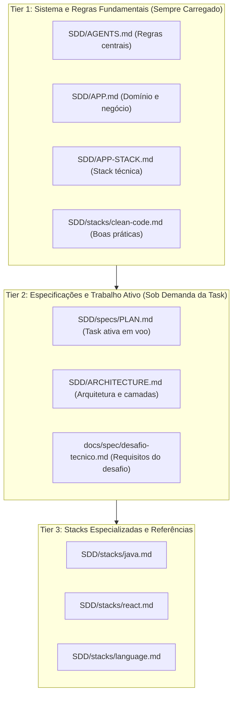

# Protocolo e Governança do AI Harness — ConsigPort

> Visão geral sobre as regras de execução, carregamento de contexto em camadas e ciclo de trabalho de agentes de IA neste repositório.
> Referências: [`../../AGENTS.md`](../../AGENTS.md), [`../../SDD/AGENTS.md`](../../SDD/AGENTS.md) e [`AI_USAGE_LOG.md`](./AI_USAGE_LOG.md).

---

## 1. O que é o AI Harness?

O **AI Harness** do ConsigPort é o conjunto de regras, convenções, scripts de checagem e estruturas documentais que permitem o desenvolvimento seguro, previsível e auditável em colaboração com agentes autônomos de Inteligência Artificial.

O repositório opera sob a metodologia **SDD (Spec-Driven Development)**:
- Nenhuma linha de código de produção é escrita sem que haja especificação prévia aprovada.
- As tarefas de engenharia são atômicas (< 1 hora de esforço, 2 a 5 arquivos por commit).
- A cada tarefa concluída, é exigida a colagem de evidências reais de execução de testes e validações.

---

## 2. Hierarquia de Contexto em Camadas (Tiered Read Order)

Para evitar alucinações e estouro de contexto de IA, os agentes devem seguir a ordem estrita de leitura definida no [`../../AGENTS.md`](../../AGENTS.md):

---

## 3. Regras Operacionais Críticas para Agentes

1. **Exatamente Uma Tarefa em Voo (`[-]`):**
   - O arquivo [`../../SDD/specs/PLAN.md`](../../SDD/specs/PLAN.md) deve conter sempre exatamente **uma** tarefa marcada como `[-]`.
   - Se uma tarefa for muito extensa, ela **deve** ser fatiada no [`../../SDD/specs/BACKLOG.md`](../../SDD/specs/BACKLOG.md) antes de ser iniciada.

2. **Registro Obrigatório de Evidências:**
   - Nenhum commit de feature ou refatoração é aceito sem execução dos testes e registro de saída no [`../../SDD/docs/EVIDENCE.md`](../../SDD/docs/EVIDENCE.md) e no checklist da tarefa no `PLAN.md`.

3. **Fronteiras Arquiteturais Rígidas:**
   - O módulo `backend/` implementa Arquitetura Hexagonal pura (Ports & Adapters).
   - O pacote `domain` não pode importar anotações de Spring (`@Component`, `@Service`, `@Transactional`, `@Entity`) nem frameworks de persistência.
   - O vocabulário externo da Central (em português) fica confinado exclusivamente aos adaptadores da ACL (`adapters/out/central/acl`).

4. **Padrão de Mensagens de Commit:**
   - Commits devem seguir o padrão Conventional Commits com anotação do agente:
     `type(scope): descrição detalhada. (Agent: NomeDoAgente - Modelo)`
   - `NomeDoAgente` e `Modelo` são os da sessão em que o commit foi escrito: o
     trailer reflete o harness e o modelo realmente usados, nunca os de uma sessão
     anterior.

5. **Modelo de Idioma:**
   - **Inglês (`en`):** Código-fonte, nomes de classes/métodos, tabelas de banco, identificadores de evento, termos de domínio e mensagens de commit.
   - **Português (`pt-BR`):** Documentação técnica, especificações SDD, ADRs, descrições do Swagger e mensagens default da API / UI.

6. **Diário de Uso de IA Obrigatório:**
   - Toda sessão que altere código, specs, contratos, scripts ou CI deve acrescentar uma entrada em [`AI_USAGE_LOG.md`](./AI_USAGE_LOG.md), com numeração contínua, data, agente/modelo, branch, objetivo e atividades realizadas.
   - O campo `Agente / Modelo` registra harness, provider e modelo usados de fato, no formato `OpenCode (NVIDIA) — MiniMax-M3.1-Flash`.
   - O portão `node scripts/check-ai-log.mjs` valida a estrutura e, no PR, exige que o log tenha sido alterado e que ao menos uma sessão nova tenha sido acrescentada.
   - Localmente, `git config core.hooksPath .githooks` instala o hook que bloqueia o commit de trabalho sem atualização do log.

---

## 4. Estratégia de Modelos: 100% Free

O ConsigPort é desenvolvido **sem nenhum custo de API**. O modelo é uma decisão de
projeto: ele precisa caber no ciclo SDD — task de até uma hora, evidência real
colada, commit pequeno — sem pagar por token.

| Sessões | Tarefas | Harness | Provider | Modelo |
|---|---|---|---|---|
| #01, #07–#09 | 0.1, 0.4, 0.5 | OpenCode | — | DeepSeek V4.1 Flash |
| #02–#06 | 0.1 a 0.4 | Antigravity | Google | Gemini 3.8 Flash |
| #10 em diante | 0.6 em diante | OpenCode | NVIDIA | MiniMax-M3.1-Flash (`nvidia/minimaxai/minimax-m3.1-flash`) |

- **Harness estável:** `OpenCode` cobre a fase inteira. O que muda entre as tasks é o
  provider e o modelo atendidos por ele, não o ferramental de execução.
- **Modelo leve:** `MiniMax-M3.1-Flash` pertence à família Flash — resposta rápida e
  consumo de contexto baixo. É o que torna o ciclo de evidência sustentável: cada task
  exige colar a saída real dos testes, e um modelo lento ou caro tornaria esse passo
  inviável.
- **Custo zero:** nenhum modelo pago entra no desenvolvimento. Adotar um exige decisão
  explícita do desenvolvedor e registro nesta política.
- **Atribuição verificável:** o par harness/provider/modelo usado na sessão é o que vai
  para o campo `Agente / Modelo` do [`AI_USAGE_LOG.md`](./AI_USAGE_LOG.md) e para o
  trailer `(Agent: ...)` do commit.

> **Quando a atribuição for corrigida:** o diário registra a correção e os commits já
> publicados mantêm o trailer original. O histórico é registro imutável, como a trilha
> de auditoria do domínio; reescrever commits publicados custaria mais do que a
> imprecisão corrigida.

---

## 5. Ferramental e Scripts de Fiscalização

Os agentes devem executar as ferramentas automatizadas para garantir conformidade antes de submeter alterações:

- `node SDD/SKILLS/check-docs/check-docs.mjs .`: Valida se todos os links relativos no Markdown resolvem com sucesso.
- `node scripts/check-specs.mjs`: Valida se as regras SDD (tarefa única em voo, arquivos obrigatórios, consistência entre PLAN e BACKLOG) estão intactas.
- `node scripts/check-ai-log.mjs`: Valida numeração, campos obrigatórios e cronologia das sessões; no PR, exige log alterado e sessão nova quando há trabalho.
- `.githooks/pre-commit`: Bloqueia commit local de trabalho sem atualização do log (ativar com `git config core.hooksPath .githooks`).
- Workflows do GitHub Actions em `.github/workflows/` aplicam os portões de qualidade no servidor.
