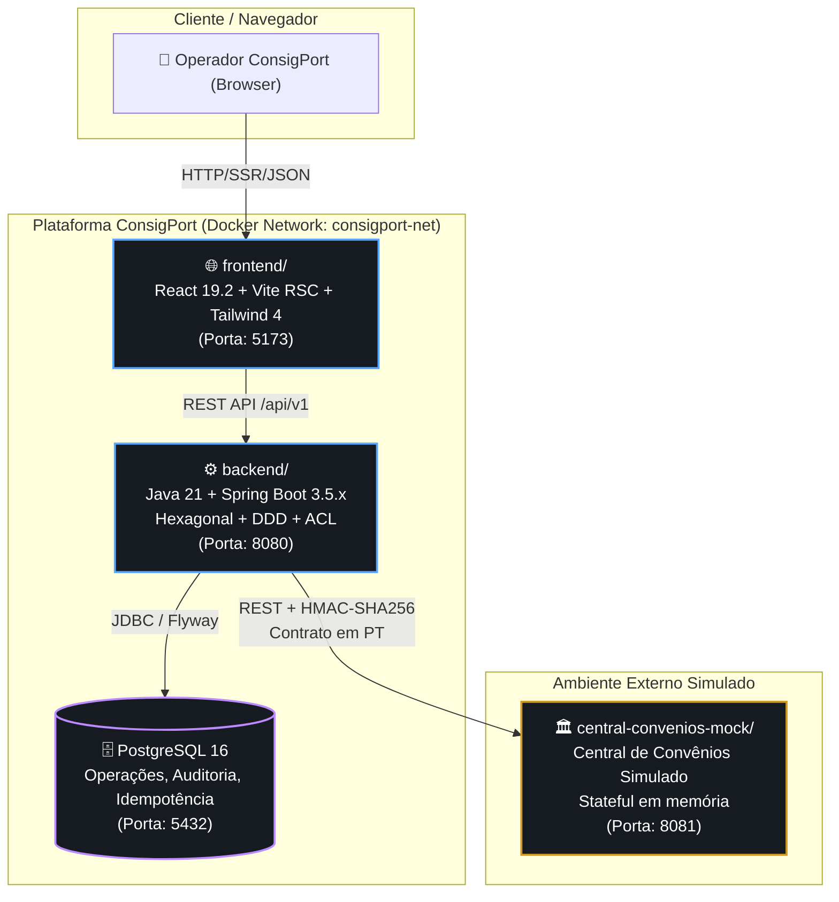
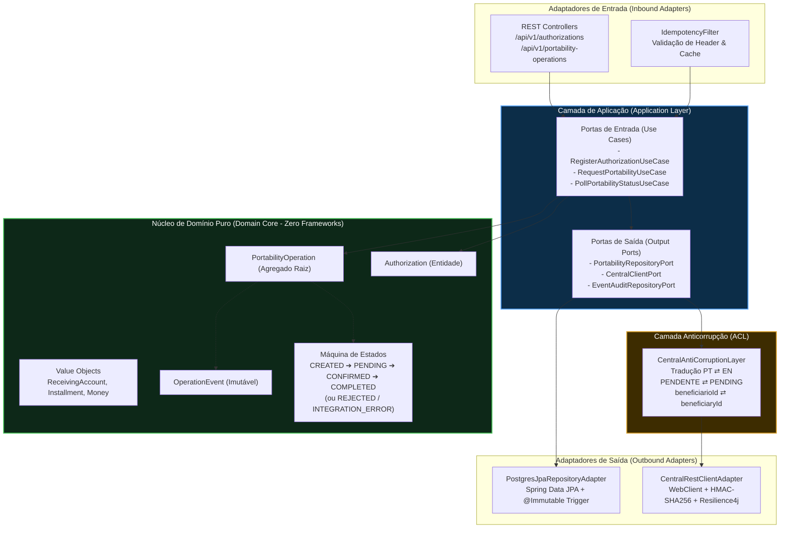
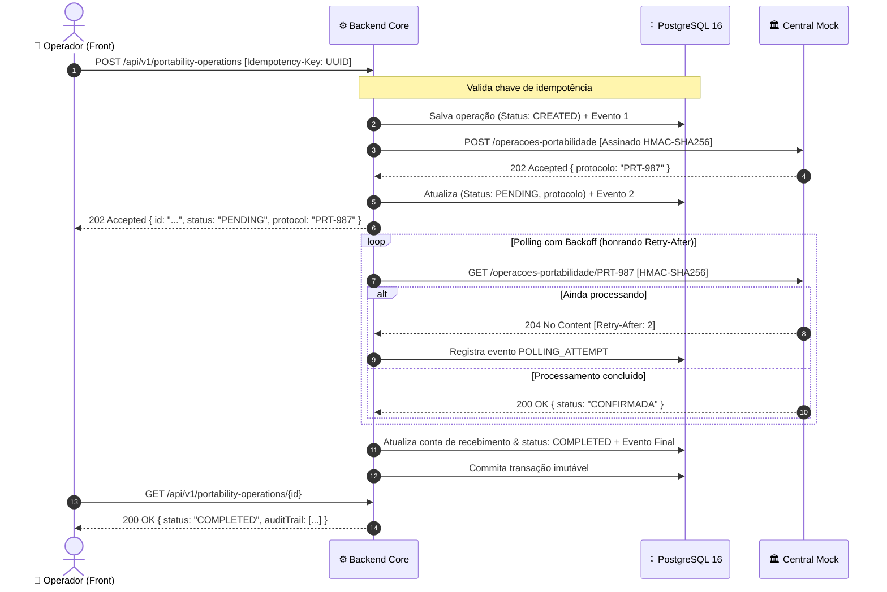

# 🏛️ Arquitetura do Sistema e Matriz de Rastreabilidade — ConsigPort

> Documento de referência visual e rastreabilidade bidirecional entre os requisitos do desafio técnico, regras de negócio de domínio (BR), decisões arquiteturais (ADRs), topologia de execução do monorepo e portões de qualidade.
>
> 🌐 **Visualizador Interativo:** Para explorar a matriz com filtros de busca, abas dinâmicas e visualização gráfica, abra o arquivo [`traceability-matrix.html`](./traceability-matrix.html) no navegador.

---

## 1. Visão Geral da Topologia do Monorepo

O ConsigPort é construído como um monorepo com três módulos executáveis desacoplados e um banco de dados relacional, orquestrados via Docker Compose:

---

## 2. Camadas da Arquitetura Hexagonal (Ports & Adapters)

O módulo `backend/` adota isolamento estrito de domínio, prevenindo que dependências de infraestrutura, Spring Framework, JPA ou o contrato em português da Central contaminem as regras de negócio:

---

## 3. Fluxo de Vida Assíncrono com Polling e Idempotência

---

## 4. Matriz de Rastreabilidade Resumida

| ID | Requisito (Desafio Técnico) | Regra de Domínio | ADR | Componente / Camada | Teste / Gate de Validação |
|:---:|---|:---:|:---:|---|---|
| **RF-01** | Captura de autorização (*opt-in*) | `BR-01, BR-02` | [ADR-0001](../adr/0001-hexagonal-ddd-acl-e-mock-isolado.md) | `backend/authorizations` + `ACL` | JUnit 5 + MockMvc + Mock da Central |
| **RF-02** | Consulta de agenda de descontos | `BR-01, BR-03` | [ADR-0001](../adr/0001-hexagonal-ddd-acl-e-mock-isolado.md) | `backend/agenda` + `CentralClient` | 403 se não autorizado; 200 com parcelas OPEN |
| **RF-03** | Seleção de parcelas e nova portabilidade | `BR-04, BR-05, BR-06` | [ADR-0001](../adr/0001-hexagonal-ddd-acl-e-mock-isolado.md) | `PortabilityOperation` (Agregado) | Validação de domínio pura; snapshot de parcelas |
| **RF-04** | Acompanhamento assíncrono do status | `BR-08, BR-09, BR-10` | [ADR-0003](../adr/0003-assincronismo-polling-e-trilha-imutavel.md) | `OperationStatusPoller` + Scheduler | Respeito a `Retry-After: 2`; terminal em COMPLETED |
| **RF-05** | Linha do tempo / Auditoria por operação | `BR-12, BR-13` | [ADR-0003](../adr/0003-assincronismo-polling-e-trilha-imutavel.md) | `operation_events` + Front Timeline | Trigger PostgreSQL contra UPDATE/DELETE |
| **RF-06** | Tratamento de rejeição e falha | `BR-11, BR-14, BR-15` | [ADR-0003](../adr/0003-assincronismo-polling-e-trilha-imutavel.md) | `GlobalExceptionHandler` + Retry | Cenários `-REJ` e `-TIMEOUT` simulados no mock |
| **RNF-01**| Integridade e assinatura HMAC-SHA256 | `APP-STACK.md §3` | [ADR-0002](../adr/0002-integridade-hmac-e-idempotencia.md) | `HmacSignatureService` | Vetor `contracts/hmac-vector.json` validado |
| **RNF-02**| Idempotência estrita via header | `BR-07, BR-15` | [ADR-0002](../adr/0002-integridade-hmac-e-idempotencia.md) | `IdempotencyFilter` + Tabela única | Teste de concorrência multithread |
| **RNF-03**| Polling assíncrono com backoff e retry | `BR-08, BR-09` | [ADR-0003](../adr/0003-assincronismo-polling-e-trilha-imutavel.md) | `Resilience4j` + Poller | Testes unitários com simulação de 204 |
| **RNF-04**| Erros de integração sem duplicação | `BR-15` | [ADR-0001](../adr/0001-hexagonal-ddd-acl-e-mock-isolado.md), [ADR-0003](../adr/0003-assincronismo-polling-e-trilha-imutavel.md) | `OperationStatus.INTEGRATION_ERROR` | Reenvio mantém chave de idempotência original |
| **RNF-05**| Trilha de auditoria append-only imutável | `BR-12, BR-13` | [ADR-0003](../adr/0003-assincronismo-polling-e-trilha-imutavel.md) | `@Immutable` + Trigger PostgreSQL | Teste SQL comprovando bloqueio de mutações |
| **RNF-06**| Código limpo e Arquitetura Hexagonal | `clean-code.md` | [ADR-0001](../adr/0001-hexagonal-ddd-acl-e-mock-isolado.md) | Pacotes `domain`, `app`, `adapters` | Testes `ArchUnit` em tempo de compilação |
| **RNF-07**| Cobertura de testes automatizados | `docs/quality/GATES.md`| [ADR-0006](../adr/0006-gitflow-ci-cd-docker-e-performance.md) | JUnit 5, Vitest, Playwright, k6 | JaCoCo &ge; 80%; E2E e k6 validados no CI |
| **RNF-08**| Contratos OpenAPI 3.1 First e i18n | `BR-16` | [ADR-0004](../adr/0004-contrato-openapi-versionamento-e-i18n.md) | `contracts/*.yaml` + Springdoc | Spectral linter + detecção de breaking change |
| **RNF-09**| Desempenho e SLAs de latência | `GATES.md §3.6` | [ADR-0006](../adr/0006-gitflow-ci-cd-docker-e-performance.md) | k6 runner (CI smoke e Nightly) | p95 &lt; 200ms em leitura; p95 &lt; 500ms em escrita |
| **REST-01**| Simulação da Central externa em memória | `central-convenios-mock`| [ADR-0001](../adr/0001-hexagonal-ddd-acl-e-mock-isolado.md) | Módulo isolado Java 21 | Sem banco; porta 8081; contrato fiel ao edital |
| **REST-02**| Frontend React 19.2 + Vite RSC + Matrix | `DESIGN.md` | [ADR-0005](../adr/0005-frontend-rsc-design-e-renderizacao.md) | Módulo `frontend/` | Sem Next.js; streaming SSR e hidratação leve |
| **REST-03**| Documentação e governança do AI Harness | `HARNESS_OVERVIEW.md` | [ADR-0006](../adr/0006-gitflow-ci-cd-docker-e-performance.md) | `docs/ai-harness/` + `AGENTS.md` | Sessões de IA registradas e rastreáveis |

---

## 5. Como Executar a Matriz Interativa

Para interagir com a matriz em modo dinâmico (filtros por tipo de requisito, pesquisa por termo em tempo real e visualizadores de camadas hexagonais):

1. Navegue até o diretório `docs/architecture/`.
2. Abra o arquivo `traceability-matrix.html` no seu navegador favorito (ex.: Google Chrome, Firefox ou Edge).
3. Utilize as abas e os campos de busca para filtrar instantaneamente requisitos, ADRs associadas e critérios de teste.
