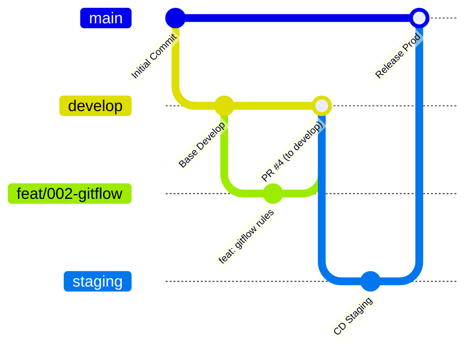

# 🔀 Política de Branches e Gitflow — ConsigPort

> Guia operacional de branches, governança de commits, isolamento por Git Worktrees e promoção de releases no ConsigPort.
> Referências: [ADR-0006](../../docs/adr/0006-gitflow-ci-cd-docker-e-performance.md) e [`GATES.md`](../../docs/quality/GATES.md).

---

## 1. Visão Geral da Topologia de Branches

O ConsigPort adota um modelo estrito de **Gitflow adaptado com proteção de branches**:



---

## 2. Papel de Cada Branch

| Branch | Papel | Proteção / Políticas | Destino de Merge Permitido |
|---|---|---|---|
| **`main`** | **Produção estável.** Código em execução em ambiente produtivo. | Protegida. Proibido push direto (`force push` desabilitado). Merge **somente vindo de `staging`**. | Deploy de produção via release aprovada. |
| **`staging`** | **Homologação.** Ambiente pré-produtivo para testes integrados. | Protegida. Recebe merges de `develop` via PR após suites de validação. | Merge para `main`. |
| **`develop`** | **Integração contínua.** Linha de base para todo o desenvolvimento ativo. | Protegida. **Nunca recebe commits diretos.** Recebe apenas PRs de branches de task. | Merge para `staging`. |
| **`feat/*`**<br>**`fix/*`**<br>**`docs/*`**<br>**`chore/*`** | **Branches atômicas de trabalho.** Criadas para cada task do [`PLAN.md`](../../SDD/specs/PLAN.md). | Branches separadas originadas de `develop`. Destino obrigatório de PR: `develop`. | Merge em `develop`. |

> 🛑 **REGRA DE OURO:** NUNCA abrir PR ou fazer push direto de uma branch de feature para a `main`. O fluxo é sempre:
> `branch de task` $\rightarrow$ `develop` $\rightarrow$ (testado e integrado) $\rightarrow$ `staging` $\rightarrow$ `main`.

---

## 3. Gestão de Branches e Uso de Git Worktrees

### 3.1. Modo Padrão: Branches Separadas no Mesmo Diretório (Single Agent)
No fluxo regular com um único agente ou desenvolvedor, utiliza-se a criação padrão de branches dentro do próprio diretório do repositório:

```bash
# 1. Garante que develop está limpa e sincronizada
git checkout develop
git pull origin develop

# 2. Cria e comuta para a branch da task
git checkout -b feat/00X-nome-da-task

# 3. Desenvolve, testa e valida localmente
node SDD/SKILLS/check-docs/check-docs.mjs .
node scripts/check-specs.mjs
node scripts/check-architecture.mjs

# 4. Commit atômico e push da branch
git add .
git commit -m "feat(scope): descrição da entrega. (Agent: NomeDoAgente - Modelo)"
git push -u origin feat/00X-nome-da-task

# 5. Abre o PR apontando estritamente para develop
gh pr create --base develop --head feat/00X-nome-da-task --title "..." --body "..."
```

### 3.2. Modo Concorrente: Git Worktrees (Apenas para Múltiplos Agentes Simultâneos)
O uso de **Git Worktrees** é reservado **exclusivamente** para cenários em que **múltiplos agentes de IA ou desenvolvedores estiverem trabalhando em paralelo ao mesmo tempo**, evitando que um agente sobrescreva arquivos ou o estado da branch do outro:

```bash
# Criação do worktree isolado em diretório irmão:
git worktree add ../consigport-task-0.X -b feat/00X-nome-da-task develop

# Navegação e trabalho isolado:
cd ../consigport-task-0.X

# Remoção do worktree após o merge do PR:
cd ../consigport-platform
git worktree remove ../consigport-task-0.X
git branch -d feat/00X-nome-da-task
```
# Retorne à raiz principal:
cd ../consigport-platform
git checkout develop
git pull origin develop

# Remova o worktree finalizado:
git worktree remove ../consigport-task-0.X
git branch -d feat/00X-nome-da-task
```

---

## 4. Proteção de Branches via GitHub CLI (`gh`)

Para assegurar que nenhum commit não autorizado chegue a `main`, `staging` ou `develop`, as regras de proteção podem ser aplicadas via GitHub CLI:

```bash
# Exemplo de configuração de branch protection rules para develop:
gh api -X PUT /repos/marcelinosandroni/consigport-platform/branches/develop/protection \
  -F required_status_checks[strict]=true \
  -F required_status_checks[contexts][]="Validate Markdown Links & Specs" \
  -F enforce_admins=false \
  -F required_pull_request_reviews[dismiss_stale_reviews]=true \
  -F required_pull_request_reviews[require_code_owner_reviews]=true \
  -F restrictions=null
```

---

## 5. Padrão de Commits

O projeto segue a convenção **Conventional Commits**:
* `feat(scope)`: Nova funcionalidade.
* `fix(scope)`: Correção de defeito.
* `docs(scope)`: Documentação e especificações.
* `chore(scope)`: Manutenção de build, configurações ou ferramentas.
* `test(scope)`: Adição ou refatoração de testes.
