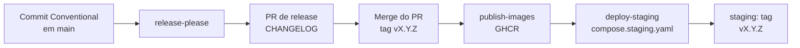

# 🚀 Release e Entrega Contínua — ConsigPort

> Como uma tag vira imagens no GHCR e um stack em staging.
> Referências: [ADR-0006](../../docs/adr/0006-gitflow-ci-cd-docker-e-performance.md),
> [`GATES.md`](../quality/GATES.md) e [`GITFLOW.md`](./GITFLOW.md).

---

## 1. Visão Geral



- **Uma versão para a plataforma inteira.** O `release-please` roda no tipo `simple`: a
  tag `vX.Y.Z` cobre backend, mock e frontend. O manifesto começa em `0.0.0`, então a
  primeira release da plataforma é a `v0.1.0`.
- **O commit Conventional é a entrada.** `feat` sobe o minor, `fix` sobe o patch, e
  commits sem impacto de versão (`chore`, `ci`, `docs`) entram no changelog sem mover a
  versão.
- **A tag é o contrato.** Tudo que roda em staging foi publicado sob aquela tag.

---

## 2. Configuração

| Arquivo | Papel |
|---|---|
| [`../../release-please-config.json`](../../release-please-config.json) | Tipo de release, caminho do CHANGELOG e regras de SemVer. |
| [`../../.release-please-manifest.json`](../../.release-please-manifest.json) | Versão corrente por pacote (`.` = plataforma). |
| [`.github/workflows/release.yml`](../../.github/workflows/release.yml) | PR de release, CHANGELOG, tag e publicação no GHCR. |
| [`.github/workflows/cd-staging.yml`](../../.github/workflows/cd-staging.yml) | Deploy de staging a partir da tag. |
| [`../../compose.staging.yaml`](../../compose.staging.yaml) | Stack de staging com as imagens publicadas. |
| `backend/Dockerfile`, `central-convenios-mock/Dockerfile`, `frontend/Dockerfile` | As três imagens, em build de múltiplos estágios. |

---

## 3. Fluxo de Release

1. **Promoção.** `develop` → `staging` → `main`, sempre por PR (ver
   [`GITFLOW.md`](./GITFLOW.md)).
2. **PR de release.** O push em `main` dispara o job `release-please`, que abre (ou
   atualiza) o PR `chore(main): release vX.Y.Z` com o CHANGELOG.
3. **Tag.** O merge desse PR cria a tag `vX.Y.Z` e a release no GitHub. Ninguém
   escreve a tag à mão: ela vem dos commits.
4. **Imagens.** No mesmo run, o job `publish-images` constrói e publica as três imagens
   no GHCR com as tags `vX.Y.Z`, `X.Y.Z` e `latest`. Uma pré-release (`v1.0.0-rc.1`)
   não move a `latest`.
5. **Staging.** O push da tag dispara o job `deploy-staging`, que sobe
   `compose.staging.yaml` com as imagens publicadas e exige healthcheck verde nos três
   serviços.

### Dry-run local

```powershell
npx release-please@17.11.2 release-pr --dry-run --repo-url https://github.com/marcelinosandroni/consigport-platform
```

> O dry-run **não** cria PR, tag nem release. Ele mostra a próxima versão e o
> changelog que seriam gerados.

---

## 4. Imagens

| Imagem | Contexto de build | Runtime | Porta |
|---|---|---|---|
| `backend` | raiz do repositório (`-f backend/Dockerfile`) | `eclipse-temurin:21-jre-alpine`, usuário `consigport` | 8080 |
| `central-convenios-mock` | raiz do repositório (`-f central-convenios-mock/Dockerfile`) | `eclipse-temurin:21-jre-alpine`, usuário `consigport` | 8081 |
| `frontend` | raiz do repositório (`-f frontend/Dockerfile`) | `node:24-alpine`, usuário `node` | 5173 |

- O contexto é a **raiz** porque o reactor Maven precisa do `pom.xml` pai.
- As imagens rodam sem privilégio e trazem `HEALTHCHECK` próprio.
- O `.dockerignore` da raiz impede que `node_modules`, `target`, `dist` e a
  documentação entrem no contexto.

Build local (o mesmo que o CI usa):

```powershell
docker build -f backend/Dockerfile -t consigport-backend:local .
docker build -f central-convenios-mock/Dockerfile -t consigport-central-mock:local .
docker build -f frontend/Dockerfile -t consigport-frontend:local .
```

---

## 5. Deploy de Staging

```powershell
$env:IMAGE_TAG = "v0.1.0"
docker compose -f compose.staging.yaml up -d --wait --wait-timeout 180
curl -fsS http://localhost:8080/actuator/health
curl -fsS http://localhost:8081/actuator/health
curl -fsS -o /dev/null http://localhost:5173/
```

- `IMAGE_REPOSITORY` aponta para o repositório no GHCR; `IMAGE_TAG` escolhe a versão.
- O stack sobe PostgreSQL 16 com volume próprio (`consigport-staging-postgres-data`).
- O run de staging é **efêmero** na Fase 0: a stack vive no runner do GitHub Actions e
  é derrubada no fim. O host persistente, a aprovação manual e o pin por digest chegam
  com a task 4.6.

---

## 6. Rollback

| Situação | Ação |
|---|---|
| Imagem com defeito | Republicar a tag anterior: `workflow_dispatch` em `release.yml` com a tag `vX.Y.Z` antiga, ou reconstruir a tag boa e republicar. |
| Staging quebrado | `workflow_dispatch` em `cd-staging.yml` com a tag anterior; o ambiente volta ao stack anterior. |
| Release errada no GitHub | Editar a release e mover a tag (`git tag -f vX.Y.Z <commit> && git push --force origin vX.Y.Z`) só com o repositório em modo admin. |

> Nenhuma tag é apagada: o histórico de releases é append-only, igual à trilha de
> auditoria do domínio.

---

## 7. Segredos

- `GITHUB_TOKEN` do próprio repositório publica no GHCR (`packages: write`) e lê os
  pacotes no deploy (`packages: read`).
- `HMAC_SECRET` e as credenciais do PostgreSQL chegam por variável de ambiente do
  ambiente de staging; nunca ficam no workflow, no log ou no commit.
